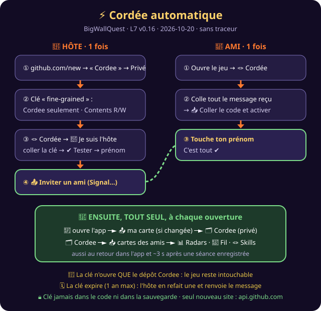

# 🔧 BigWallQuest — Cordée automatique : guide de l'HÔTE
**Outil :** BigWallQuest · **Version :** L7 v0.16 · **Générée le :** 2026-10-20 · ⏱ environ 5 minutes, une seule fois

## ① Créer le dépôt privé (1 min)
| # | Où | Quoi |
|---|---|---|
| 1 | https://github.com/new | **Repository name** : `Cordee` |
| 2 | même page | coche **Private** 🔒 |
| 3 | même page | **Create repository** |

## ② Créer la clé limitée à ce dépôt (2 min)
| # | Où | Quoi |
|---|---|---|
| 1 | https://github.com/settings/personal-access-tokens/new | (ou : photo → Settings → Developer settings → Personal access tokens → **Fine-grained tokens** → Generate new token) |
| 2 | **Token name** | `BigWallQuest Cordee` |
| 3 | **Expiration** | la plus longue proposée (1 an max) |
| 4 | **Repository access** | **Only select repositories** → `Cordee` ⚠️ surtout **pas** BigWallQuest2000 |
| 5 | **Permissions → Repository permissions** | **Contents** → **Read and write** (rien d'autre) |
| 6 | bas de page | **Generate token** → **copie** la clé (elle commence par `github_pat_`) |

> ⚠️ GitHub ne montre la clé qu'**une fois**. Si tu la perds, refais l'étape ②.

## ③ Activer dans le jeu (1 min)
1. Ouvre le jeu → **🪢 Cordée** (onglet 🔄 Synchro si la cordée existe déjà).
2. **🔧 Je suis l'hôte : créer le code**.
3. Vérifie le dépôt (`poussijousse/Cordee`, pré-rempli) → colle la clé → **✔ Tester et activer**.
4. Touche **ton prénom** → la première synchro se lance (barre de progression).

## ④ Inviter les amis
**📤 Inviter un ami** → choisis Signal, SMS ou courriel → envoie. Le message contient le code, le lien et 3 étapes.

## ⑤ Partager des voies Mountain Project (v0.17)
| # | Où | Quoi |
|---|---|---|
| 1 | mountainproject.com/route-finder (Safari : **aA → site pour ordinateur**) | choisis la région → **Find Routes** → **Export CSV** (1000 voies max par fichier) |
| 2 | github.com → dépôt **Cordee** → **Add file → Create new file** (une seule fois) | nom : `voies/LISEZMOI.md`, texte : « voies de la cordée » → **Commit changes** (GitHub ne crée pas de dossier vide) |
| 3 | dans le dossier `voies` : **Add file → Upload files** | choisis le CSV (Fichiers → Téléchargements) → **Commit changes** |
| 4 | jeu → 🪢 Cordée → 🔄 Synchroniser | « 🧗 Voies de la cordée : N » sur tous les téléphones |

- Un fichier par région (ex. `Laurentides.csv`, `Charlevoix.csv`). Pour mettre à jour : réimporte un fichier avec le **même nom**.
- Les voies restent dans le dépôt **privé** : jamais dans le dépôt public du jeu.

## Bon à savoir
- 🔑 **Pire cas si la clé fuit** : quelqu'un modifie ou efface des cartes. Le jeu contrôle chaque carte, donc rien ne peut s'exécuter. Remède : GitHub → la clé → **Revoke**, puis refais ② et ③ et renvoie le message.
- 🗓 **Expiration** : quand la clé expire, le jeu affiche « clé refusée ». Refais ② et ③, puis renvoie le message.
- 🧹 **Retirer un ami** : supprime son fichier `cartes/<prénom>.json` dans le dépôt `Cordee`. Sa carte disparaît des téléphones à la synchro suivante.
- 👥 **8 amis maximum** affichés.
- 🔄 L'ancienne « Boîte aux lettres » et la cordée avec code fonctionnent toujours, mais la cordée automatique les remplace.
