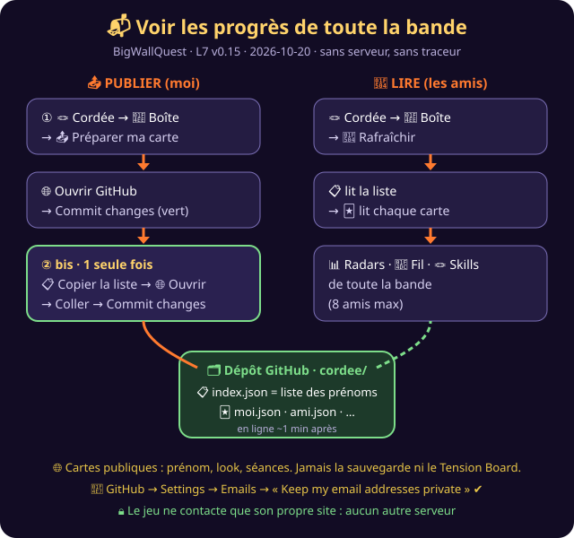

# 📬 BigWallQuest — Voir les progrès de toute la bande
**Outil :** BigWallQuest · **Version :** L7 v0.15 · **Générée le :** 2026-10-20

## Avant de commencer (une seule fois)
| # | Qui | Quoi |
|---|---|---|
| 1 | chaque ami | crée un compte GitHub |
| 2 | chaque ami | GitHub → Settings → Emails → coche **« Keep my email addresses private »** 🔒 |
| 3 | l'hôte du jeu | dépôt → Settings → Collaborators → **invite** l'ami |
| 4 | chaque ami | accepte l'invitation (courriel de GitHub) |

## 📤 Publier ma carte
| # | Tu fais | Tu vois |
|---|---|---|
| 1 | Ouvre le jeu depuis son **adresse en ligne** (…github.io/…) | |
| 2 | 🪢 Cordée → 📮 Boîte aux lettres → **📤 Préparer ma carte** | barre de progression jusqu'à 100 % |
| 3 | **🌐 Ouvrir GitHub** → **Commit changes** (bouton vert) | ta carte est publiée |
| 4 | **Seulement si le cadre vert « ② bis » apparaît** : 📋 Copier la liste → 🌐 Ouvrir la liste → tout sélectionner → Coller → **Commit changes** | ton prénom est dans la liste |

## 🔄 Voir la bande
🪢 Cordée → 📮 Boîte aux lettres → **🔄 Rafraîchir la cordée**. Les cartes de tous les amis de la liste arrivent toutes seules.

## Bon à savoir
- ⏱ Une publication est visible **environ 1 minute** après le Commit (parfois jusqu'à 10 min, à cause du cache de GitHub).
- 🔁 Le cadre « ② bis » revient ? Ton prénom a sauté de la liste (deux ajouts en même temps). Refais l'étape 4 : c'est prévu.
- 👥 **8 amis maximum** à l'écran. Au-delà, le jeu dit qui n'est pas affiché.
- 🌐 Les cartes sont **publiques** : prénom, look, séances. Ni la sauvegarde, ni les autres persos, ni les problèmes Tension Board.
- 🧹 Retirer quelqu'un : l'hôte supprime son prénom dans `cordee/index.json` et son fichier `cordee/<prénom>.json` sur GitHub.
