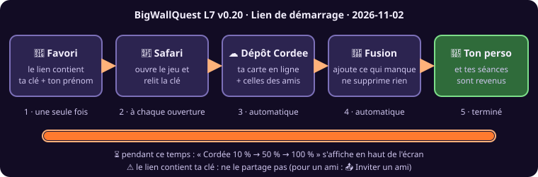

# 🔖 BigWallQuest — Lien de démarrage (retrouver ton perso à chaque ouverture)
**Outil :** BigWallQuest · **Version :** L7 v0.20 · **Générée le :** 2026-11-02 · ⏱ environ 3 minutes, une seule fois

## À quoi ça sert
Si la mémoire de ton téléphone se vide, ton perso et tes séances reviennent **tout seuls** à chaque ouverture, depuis ta carte sur le dépôt `Cordee`. Rien à coller, rien à toucher.

## Mise en place (une seule fois)
| # | Où | Quoi | Tu vois |
|---|---|---|---|
| 1 | Jeu → 🪢 Cordée → 🔄 Synchro | Touche ton prénom si ce n'est pas fait, puis **🔄 Synchroniser maintenant** | « Cordée à jour ✔ » (ta carte en ligne reprend tes séances) |
| 2 | même écran | **🔖 Mon lien de démarrage (à mettre en favori)** | la feuille de partage : choisis **Copier** (ou Notes) |
| 3 | Safari | colle le lien dans la barre d'adresse → **Aller** | le jeu s'ouvre, la barre d'adresse **garde** le lien |
| 4 | Safari | **Partager → Ajouter aux favoris** | un favori « BigWallQuest » |

> 💡 Variante : **Partager → Sur l'écran d'accueil**, puis désactive « **Ouvrir comme app web** » : l'icône ouvre Safari, donc ton favori avec son lien.

## À chaque ouverture
1. Ouvre le jeu **par ce favori** (pas par une autre icône).
2. Un message « ⏳ Cordée 10 % … 50 % … » s'affiche : le jeu relit ta carte.
3. Tu vois « ✔ N activités retrouvées » si quelque chose manquait, puis tes amis se mettent à jour.

## Important
- ⚠️ **Le lien contient ta clé.** Ne le partage pas, ne le mets pas dans une capture d'écran. Pour un ami, utilise **📤 Inviter un ami**.
- 📤 **Seul ce qui est sur ta carte revient** : prénom, look, séances. Tes voies importées, réglages et problèmes de board **ne reviennent pas** : continue à faire **💾 Préparer ma sauvegarde** de temps en temps.
- ⏱ Une séance est envoyée quelques secondes après son enregistrement. Si tu fermes tout de suite, ouvre le jeu une fois de plus et attends « Cordée à jour ✔ ».
- 🛡 Si ta carte en ligne est **plus pleine** que ton téléphone, le jeu ne l'écrase jamais (v0.19.1).
- 🚫 Pas de réseau : rien n'est lu, ton perso reviendra à la prochaine ouverture avec connexion.
- 🔄 Perso introuvable en ligne (nouvelle personne) : le jeu synchronise quand même, puis touche ton prénom dans Cordée.
