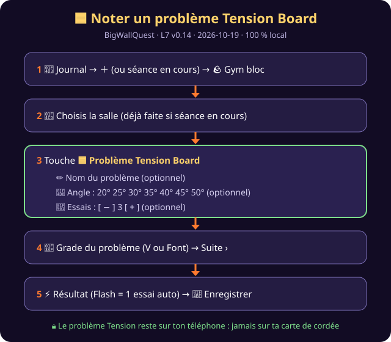

# 🟦 BigWallQuest — Noter un problème Tension Board
**Outil :** BigWallQuest · **Version :** L7 v0.14 · **Générée le :** 2026-10-19

## En 5 taps

| # | Tu fais | Tu vois |
|---|---|---|
| 1 | 📓 Journal → ＋ → 🪨 **Gym bloc** | la liste des salles |
| 2 | 📍 Touche ta salle | elle devient orange |
| 3 | Touche **🟦 Problème Tension Board** | un cadre vert s'ouvre |
| 4 | Remplis ce que tu veux : ✏️ nom · 📐 angle · 🔁 essais, puis le **grade** → Suite › | les choix deviennent orange |
| 5 | Choisis le résultat → 💾 **Enregistrer** | ✔ Enregistré + tes gains |

## Bon à savoir
- ✅ **Tout est optionnel** : juste le bouton 🟦 suffit pour dire « c'était sur la Tension ».
- ⚡ **À vue / Flash** = 1 essai : le jeu le met tout seul.
- 🔁 Retirer un angle : retouche-le. Retirer les essais : − jusqu'à « – ».
- 🔒 **Vie privée** : le problème Tension reste sur ton téléphone. Il n'est **jamais** envoyé sur ta carte de cordée. Il est gardé dans ta sauvegarde et dans l'export CSV (colonne `probleme_tension`).
- 📈 Les points gagnés sont les mêmes que pour n'importe quel bloc du même grade.

## Mettre à jour le jeu (pour la personne qui héberge)
1. Dépose `index.html` et `sw.js` sur le site.
2. Ferme puis rouvre l'app 1 à 2 fois.
3. Vérifie en bas du menu : **L7 · v0.14 · 2026-10-19**.
